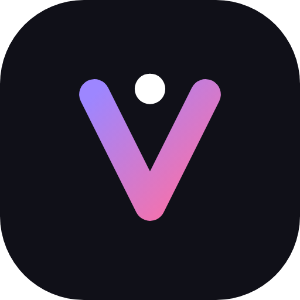
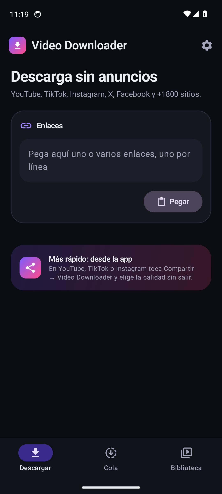
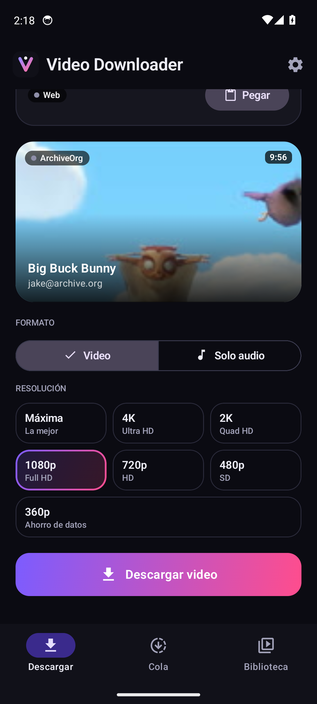
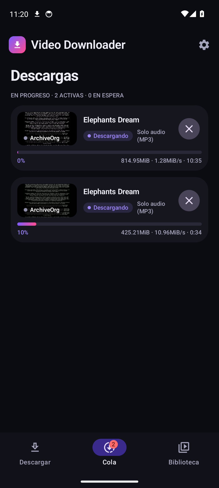
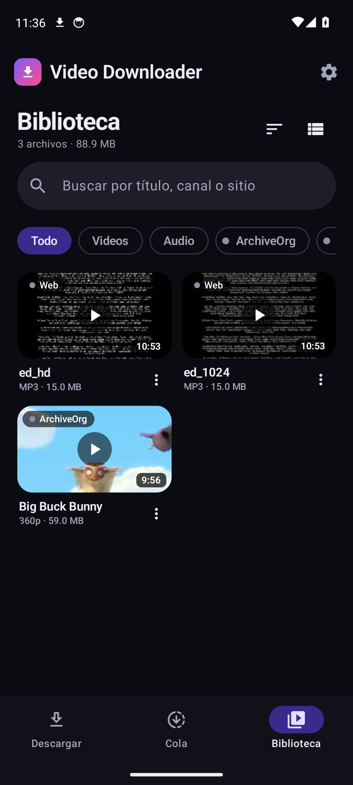
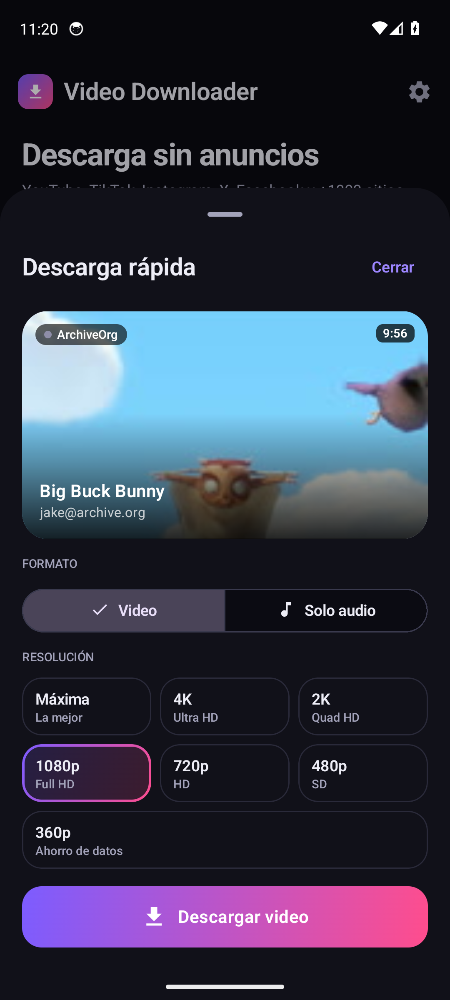
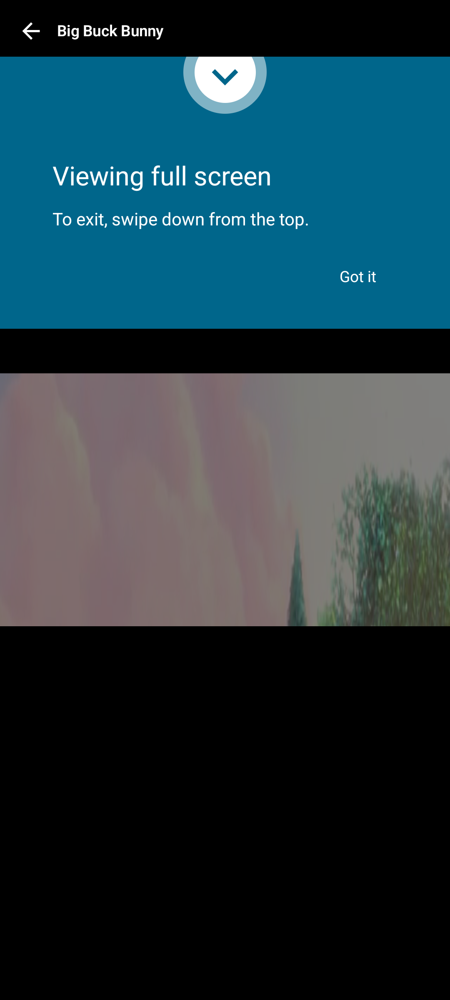
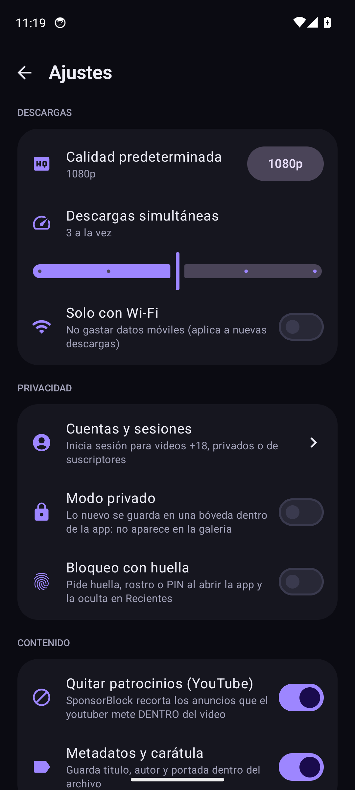
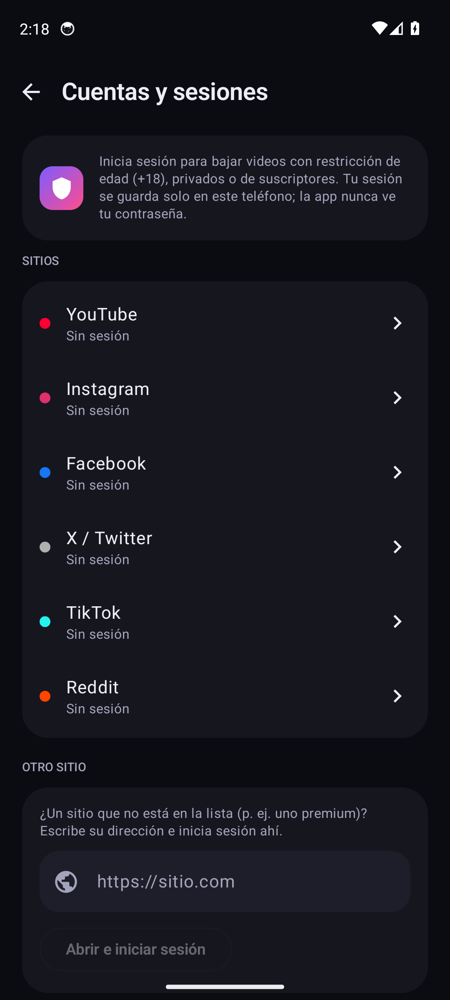

<p align="center">
  
</p>

<h1 align="center">Video Downloader</h1>

<p align="center">
  App Android de uso personal para descargar videos <b>sin anuncios</b> de YouTube, TikTok, Instagram,
  Facebook, X, Twitch, Reddit y <a href="https://github.com/yt-dlp/yt-dlp/blob/master/supportedsites.md">+1800 sitios</a>.
  <br/>Pegas el enlace, eliges la calidad y listo.
</p>

<p align="center">
  <a href="../../releases/tag/latest"><b>⬇️ Descargar el APK</b></a>
</p>

<p align="center">
  
  
  
  
</p>
<p align="center">
  
  
  
  
</p>

---

## Funciones

**Descargar**
- Pegas uno o varios enlaces, o usas **Compartir → Video Downloader** desde cualquier app.
  Al compartir se abre una **hoja rápida**: eliges calidad y descargas sin salir de lo que veías.
- Al pegar un enlace, la app lo **analiza sola**: miniatura, duración, canal y las resoluciones
  disponibles con el **tamaño estimado** de cada una.
- Formato **Video** (Máxima, 4K, 2K, 1080p, 720p, 480p, 360p) o **Solo audio** (MP3 con carátula).
- Las **listas de reproducción** se separan en un video por descarga.
- **SponsorBlock**: recorta los patrocinios que el youtuber mete *dentro* del video.

**Cola**
- **Descargas múltiples**: de 1 a 5 a la vez (configurable); el resto espera su turno.
- Progreso, velocidad y tiempo restante. Puedes cancelar, reintentar o deslizar para quitar.
- Las descargas siguen aunque cierres la app, con su notificación de progreso.

**Biblioteca**
- Cuadrícula o lista, búsqueda, filtros por tipo (video, audio) y por sitio, y orden.
- **Reproductor integrado** a pantalla completa. También puedes abrir con otra app o compartir.
- Los archivos van a la galería: `Movies/VideoDownloader` (video) y `Music/VideoDownloader` (audio).

**Privacidad**
- **Cuentas y sesiones**: inicias sesión en un navegador dentro de la app (YouTube, Instagram,
  Facebook, X, TikTok, Reddit o cualquier otro sitio) para descargar contenido con restricción de edad, privado o de
  suscriptores. La sesión se guarda solo en el teléfono; la app nunca ve tu contraseña.
- **Bóveda 🔒**: una biblioteca aparte, protegida con huella, rostro o PIN. Al descargar eliges
  "Guardar en la Bóveda" y ese video se guarda en el almacenamiento interno de la app: no aparece en la
  galería, ni en la biblioteca normal, ni con su título en la cola o las notificaciones. Pide huella cada
  vez que entras y se cierra sola al salir de la app.
- **Bloqueo con huella**: pide huella, rostro o PIN del teléfono cada vez que abres o regresas a la app.
  Con el bloqueo activo, la app se ve en negro en "Recientes" y no permite capturas.

**Ajustes**
- Calidad predeterminada, descargas simultáneas, solo Wi-Fi, metadatos y tema claro/oscuro/sistema.
- El motor (yt-dlp) se actualiza solo una vez al día, y también a mano desde Ajustes.

## ¿Qué enlaces acepta?

| Tipo | Ejemplos | ¿Funciona? |
|---|---|---|
| Redes y plataformas de video | YouTube (incl. Shorts y listas), TikTok, Instagram, Facebook, X, Threads, Reddit, Pinterest, Vimeo, Dailymotion, Bilibili | ✅ |
| Streaming y clips | Twitch (VODs y clips), Kick, YouTube en vivo (desde el momento actual) | ✅ |
| Audio | SoundCloud, Bandcamp, Mixcloud, audio de cualquier video | ✅ |
| Archivos directos | Enlaces que terminan en `.mp4`, `.webm`, `.mov`, `.mp3`… | ✅ |
| Streams "en trozos" | `.m3u8` (HLS) y `.mpd` (DASH): noticias, cursos, TV en línea | ✅ |
| Páginas con un reproductor incrustado | Blogs y sitios con `<video>`, JW Player, etc. | ✅ casi siempre |
| Sitios para adultos | La mayoría de los populares, sin cuenta | ✅ |
| Contenido con login | Videos de YouTube con restricción de edad, videos privados, Instagram/Facebook privados, Vimeo, sitios premium | ✅ inicia sesión en Ajustes → *Cuentas y sesiones* |
| Plataformas con DRM | Netflix, Prime Video, Disney+, HBO Max, Spotify, Apple Music | ❌ cifrado; ninguna herramienta legal lo descarga |

Si un sitio que antes funcionaba empieza a fallar, casi siempre se arregla con
**Ajustes → yt-dlp → Actualizar**: los sitios cambian seguido y yt-dlp se adapta rápido.

## Instalarla en tu celular

No necesitas Android Studio: GitHub compila la app en la nube.

### 1. Descargar el APK
1. Desde el navegador del celular abre **[Releases → latest](../../releases/tag/latest)**.
2. En **Assets** toca **`VideoDownloader-arm64-v8a.apk`**: es el de casi cualquier celular de
   los últimos ~8 años.
   - Si al instalar dice "no compatible", usa `armeabi-v7a` (celulares muy viejos de 32 bits).
   - `x86_64` es solo para emuladores.

### 2. Instalar
1. Abre el archivo descargado (notificación o **Archivos → Descargas**).
2. Android dirá que tu navegador no puede instalar apps: toca **Configuración**, activa
   **"Permitir de esta fuente"** y regresa.
3. Toca **Instalar**. Si **Google Play Protect** avisa que no reconoce la app, toca
   **Más detalles → Instalar de todas formas** (sale porque no viene de la Play Store).

### 3. Primer uso
1. La primera vez tarda unos segundos en "preparar el motor" (descomprime Python y ffmpeg).
2. Acepta el permiso de **notificaciones** para ver el progreso con la app cerrada.
3. Pruébala: en YouTube toca **Compartir → Video Downloader**.

### 4. Actualizar
- Cada `push` al repo dispara GitHub Actions (`.github/workflows/build-apk.yml`), que en
  ~5–8 minutos compila y reemplaza el APK en **Releases → latest**. El avance se ve en la pestaña **Actions**.
- Instala el APK nuevo **encima** del anterior: conservas tu biblioteca y ajustes, porque todos los
  APK se firman con la misma llave (`app/signing.keystore`).
- Para compilar a mano: **Actions → Build APK → Run workflow** (aparece cuando el workflow está en `main`).

> La llave de firma está en el repo a propósito, para que cada compilación en la nube se pueda
> instalar encima de la anterior. Como es pública, no la uses para publicar en tiendas.

## Cómo funciona (el "por qué")

No hay backend: todo corre en el teléfono.

```
┌──────────── APK ────────────────────────────────────────────┐
│ UI (Jetpack Compose) ──► ViewModel ──► DownloadController   │
│                                           │ WorkManager      │
│                                           ▼                  │
│                         DownloadWorker (1 por descarga)      │
│                                           │ ejecuta proceso  │
│                                           ▼                  │
│            python + yt-dlp + ffmpeg (binarios ARM nativos)   │
│                                           │                  │
│      carpeta privada ──copia──► MediaStore (galería)         │
│                     Room/SQLite = cola + biblioteca          │
└──────────────────────────────────────────────────────────────┘
```

- **yt-dlp** es quien "sabe" descargar de cada sitio. La librería
  [youtubedl-android](https://github.com/JunkFood02/youtubedl-android) mete Python y ffmpeg
  compilados para ARM dentro del APK, así cada descarga es un proceso `python yt-dlp …` local.
  Por eso no hace falta servidor: la descarga sale de la IP de tu celular, como un usuario normal.
- **ffmpeg** une video + audio: YouTube sirve todo lo mayor a 720p en pistas separadas.
- **WorkManager**: Android mata los hilos de apps en segundo plano para ahorrar batería.
  WorkManager corre la descarga como servicio en primer plano y la retoma si se interrumpe.
- **MediaStore**: desde Android 10 las apps no escriben libremente en carpetas públicas.
  Se descarga en la carpeta privada y al final se copia a la galería, sin pedir permisos.
- **Sesiones**: el navegador integrado guarda las cookies de tu login; se exportan al formato
  `cookies.txt` que entiende yt-dlp, para que descargue "como si fueras tú".
- **BiometricPrompt**: la huella nunca llega a la app; Android solo responde "sí, es el dueño".

| Pieza | Equivalente en .NET |
|---|---|
| Kotlin coroutines (`suspend`, `launch`) | `async/await`, `Task` |
| Jetpack Compose | Blazor / XAML, pero declarativo en código |
| ViewModel + StateFlow | MVVM con `INotifyPropertyChanged` |
| Room (`@Entity`, `@Dao`) | Entity Framework Core |
| WorkManager | Hangfire / `BackgroundService` |
| SharedPreferences | `appsettings.json` del usuario |
| BiometricPrompt | Windows Hello |
| Gradle (`build.gradle.kts`) | `.csproj` + NuGet |

## Diseño

- **Logo**: monograma "V" de Video cuyo vértice es la punta de una flecha de descarga.
  Vectorial (`res/drawable/ic_launcher_foreground.xml`), con versión monocromática para los
  íconos temáticos de Android 13+.
- **Sistema de diseño** en `ui/theme/Theme.kt`: paleta oscura de marca (violeta → rosa),
  esquinas redondeadas generosas y tipografía con jerarquía clara.
- **Componentes** en `ui/components/Components.kt`: botón con degradado, mosaicos de calidad,
  insignias por plataforma, pastillas de estado, barras de progreso animadas y *skeleton loading*.
- Material 3 + Jetpack Compose: hoja inferior, botones segmentados, chips de filtro,
  deslizar para quitar, transiciones animadas y reproductor en pantalla completa inmersiva.

## Estructura

```
app/src/main/java/com/brandon/videodownloader/
├── App.kt              # arranque e inyección de dependencias manual
├── data/               # Room (Download, DAO, base de datos) y ajustes del usuario
├── engine/             # yt-dlp: iniciar, actualizar, analizar URL, calidades, sesiones (cookies)
├── download/           # worker, cola, límite de descargas, galería/bóveda, notificaciones
└── ui/                 # Activity, ViewModel, tema, componentes, bloqueo con huella
    └── screens/        # Descargar, Cola, Biblioteca, Reproductor, Ajustes, Cuentas, Bloqueo
```

## Capturas automáticas

El workflow **Screenshots** (`.github/workflows/screenshots.yml`) levanta un emulador Pixel 7 en
GitHub, instala la app, la recorre (compartir enlace, analizar, descargar, biblioteca, reproductor,
ajustes) y publica las capturas en **[Releases → screenshots](../../releases/tag/screenshots)**.
Corre solo cuando cambia la interfaz.

## Compilar en tu computadora (opcional)

Con Android Studio o el SDK de Android instalado:

```bash
./gradlew assembleRelease
# APKs en app/build/outputs/apk/release/
```

## Aviso

Proyecto de uso personal. Respeta los derechos de autor y los términos de cada sitio.

Las capturas usan videos de muestra libres: *Big Buck Bunny* y *Elephants Dream*
© Blender Foundation, licencia [CC BY](https://creativecommons.org/licenses/by/3.0/).
